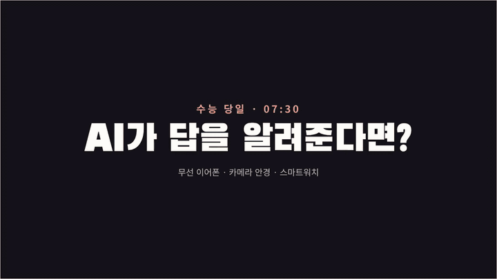

# Until 08:10 — 입실 마감 08:10

> 수능 당일 아침 07:30, 시험장 정문 검색대.
> **08:10 입실 마감 전까지** 줄 선 응시자 중 AI 부정행위자를 가려내세요.



▶ [고화질 티저 영상 (MP4)](media/teaser.mp4) · 📱 [릴스·쇼츠용 세로 티저 (1080×1920, 효과음만 포함)](media/teaser_reels.mp4)

AI 이어폰, 카메라 안경, 스마트워치처럼 시험장 밖 AI에게 답을 묻는 수법이 늘고 있습니다.
당신은 검색대 감독관입니다. 응시자의 몸을 돌려 보고, 확대하고, 도구로 조사한 뒤
**입실 허가** 또는 **부정행위 적발**을 고르세요. 도구를 쓸 때마다 시계가 흐릅니다.

설치나 빌드 없이 브라우저에서 바로 돌아가는 3D 웹 게임입니다 (three.js + VRM 캐릭터).

---

## 바로 플레이

### 내 컴퓨터에서

`index.html`을 더블클릭하면 브라우저 보안 정책 때문에 3D 모델을 불러오지 못합니다. 웹 서버로 여세요.

```bash
cd docs
```

```bash
python -m http.server 8000
```

브라우저에서 http://localhost:8000 을 엽니다.

### GitHub Pages

게임 전체가 `docs/` 폴더에 정적 파일로 들어 있습니다.
저장소 **Settings → Pages → Branch: `main` / 폴더: `/docs`** 로 지정하면
`https://diosong529.github.io/Until-08-10/` 에서 바로 플레이할 수 있습니다.

itch.io, Netlify Drop 배포 방법은 [`docs/README.md`](docs/README.md)를 보세요.

---

## 게임 방법

### 진행

- 근무는 **5일**입니다. 하루 응시자는 5~7명, 시계는 07:30에서 시작합니다.
- 도구를 쓸 때마다 시간이 흐르고, **08:10**이 되면 남은 응시자는 미처리로 끝납니다.
- 확대해서 눈으로 살펴보는 것은 시간이 들지 않습니다. 모든 반입 물품은 눈으로 찾을 수 있는 흔적을 남깁니다.

### 조사 도구

| 키 | 도구 | 시간 | 설명 |
|---|---|---|---|
| 1 | 육안 확인 | 0.5분 / 부위 | 고른 부위를 자세히 보고 기록 |
| 2 | 금속탐지기 | 2분 | 전신을 훑어 금속 반응 세기를 표시 (벨트·안경에도 울림) |
| 3 | 정밀수색 | 1.5분 / 부위 | 고른 부위에서 숨긴 물건을 꺼냄 |
| 4 | 필통 검사 | 1.5분 | 필통 속 계산기·쪽지 확인 |
| 5 | 명단 조회 | 1분 | 응시자 명단 사진과 대조 (2일차부터) |
| 6 | 전파탐지기 | 1.5분 | 무선 신호가 나오는 부위 표시 (3일차부터) |
| 7 | 생년월일 질문 | 1분 | 대답과 반응으로 대리 응시·이어폰 착용 판단 |

### 날마다 바뀌는 규정

| 일차 | 새 상황 |
|---|---|
| 1일차 | 휴대폰·스마트워치·무선 이어폰·쪽지·계산기 반입 금지 |
| 2일차 | 대리시험 첩보, **명단 조회** 개방, 카메라 안경·단추형 카메라 등장 |
| 3일차 | 초소형 무선 이어폰 유통, **전파탐지기** 지급 |
| 4일차 | 아날로그를 포함한 **모든 손목시계** 반입 금지 |
| 5일차 | 보청기는 명단에 사전 신고가 있을 때만 허용 |

### 점수

| 결과 | 점수 |
|---|---|
| 부정행위자 적발 | +100 |
| 정상 응시자 입실 | +50 |
| 무고한 응시자 퇴실 | −150 |
| 부정행위자 통과 | −100 |
| 마감 시간까지 미처리 | −30 |

5일 근무가 끝나면 정확도와 실수에 따라 **명감독관 / 공포의 감독관 / 구멍 난 검색대 / 느림보 감독관 / 평범한 감독관** 칭호를 받습니다.

### 조작

- 몸의 부위 클릭: 확대 · 드래그: 돌리기 · 휠/핀치: 줌
- 빈 곳 클릭, 우클릭, `Space`, `Esc`, "← 전체 보기": 전체 보기로 돌아가기
- `1`~`7`: 도구 단축키

---

## 폴더 구성

```
.
├── README.md            이 문서
├── media/
│   ├── teaser.mp4       티저 영상 (1280×720, 30fps)
│   ├── teaser_reels.mp4 릴스·쇼츠용 세로 티저 (1080×1920, 28초, 효과음만 · 배경음악은 릴스에서 추가)
│   └── teaser.gif       README용 미리보기
└── docs/                게임 본체 (정적 사이트 루트)
    ├── index.html       게임 코드 (HTML·CSS·JS 한 파일)
    ├── lib/             three.js 0.160.0, three-vrm 3.1.0 (CDN 없이 동작)
    ├── models/          캐릭터 VRM 모델 6개 (약 45MB)
    ├── CREDITS.md       모델·라이브러리 출처와 라이선스
    └── README.md        배포 방법 (itch.io / Netlify / GitHub Pages)
```

## 출처

캐릭터 모델(VRoid AvatarSample A·B·C, VRM1 Constraint Twist Sample, Seed-san, 니코니 입체짱)과
라이브러리의 출처·라이선스·배포 시 주의사항은 [`docs/CREDITS.md`](docs/CREDITS.md)에 정리되어 있습니다.
특히 게임을 **유료로 판매**하거나 **법인 명의로 배포**하려면 먼저 해당 문서의 주의 사항을 확인하세요.
